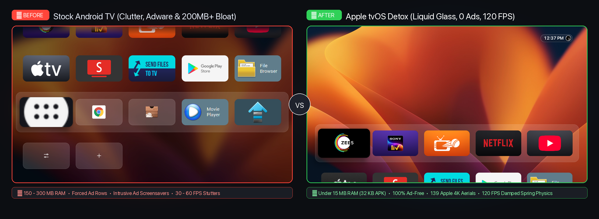
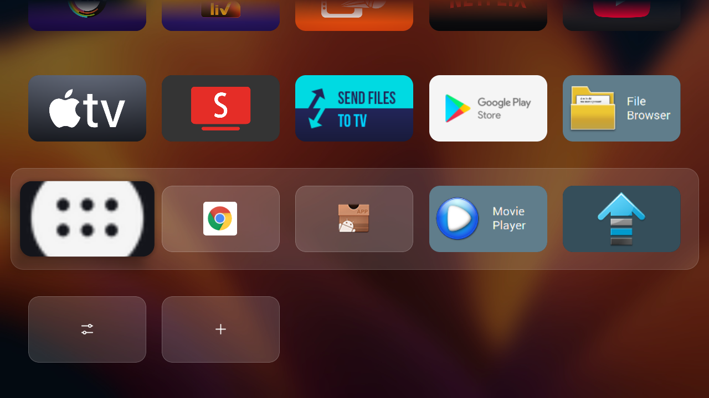
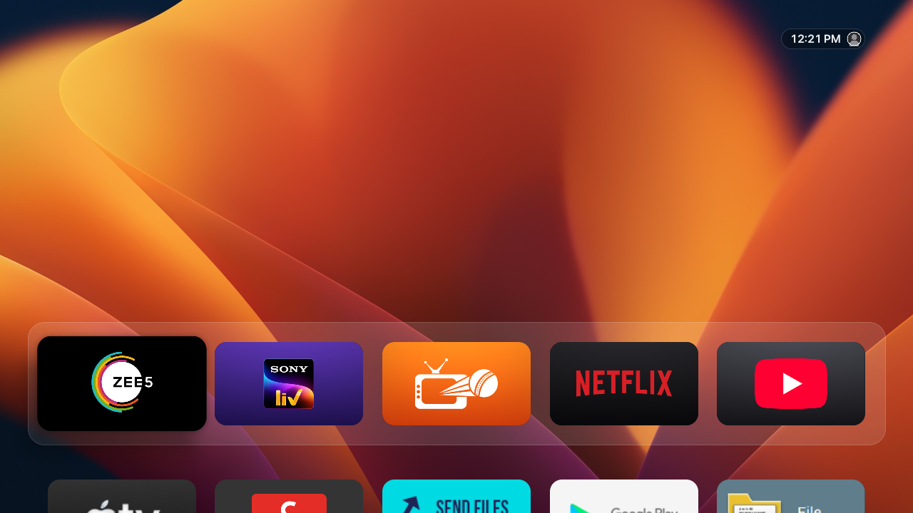

# 🍏 tvOS Detox: Apple TV Experience for Any Android TV Box

[](LICENSE)
[](https://github.com/ombichave999/apple-tvos-android-tv/releases/latest)
[](#hardware-compatibility)
[](https://github.com/ombichave999/apple-tvos-android-tv/releases/latest/download/tvhome.apk)
[-orange.svg)](#features)
[](#contributing)

> Transform cheap, sluggish, ad-bloated Android TV boxes into a **clean, blazing-fast, authentic Apple tvOS experience**. Zero ads, liquid glass dock, 120 FPS spring physics, and official Apple 1080p/4K Aerial screensavers with prominent clock and location tags.

---

## 📸 Before vs After

<p align="center">
  
</p>

<table>
  <tr>
    <th width="50%" align="center">❌ BEFORE: Stock Android TV</th>
    <th width="50%" align="center">🍏 AFTER: Apple tvOS Detox</th>
  </tr>
  <tr>
    <td align="center">
      
      <br />
      <em>Bloated with sponsored rows, adware popups, and a 200MB+ memory footprint.</em>
    </td>
    <td align="center">
      
      <br />
      <em>Clean Apple Liquid Glass frosted pill dock, personalized profile pill, and zero ads.</em>
    </td>
  </tr>
</table>

<details>
<summary><b>🔍 View Full App Grid (Click to expand)</b></summary>
<br />
<p align="center">
  
  <br />
  <em>Symmetric widescreen 16:9 card grid with proper Z-order focus scaling and 120 FPS damping spring physics.</em>
</p>
</details>

---

## ⚡ The Problem vs The tvOS Detox Solution

Most budget and generic Android TV boxes (Amlogic, Rockchip, Allwinner) ship with malware, intrusive adware screensavers, forced promotional rows, and sluggish 200MB+ home launchers.

| Metric / Feature | Stock Android TV / Cheap Box | 🍏 tvOS Detox |
| :--- | :--- | :--- |
| **Ads & Promos** | Forced ad banners & sponsored rows | **100% Ad-Free (Zero ads)** |
| **Launcher Footprint** | 150 MB – 300 MB RAM | **Under 15 MB RAM (32 KB APK)** |
| **Animation Physics** | Stuttery 30-60 FPS | **120 FPS buttery spring damping** |
| **Dock & UI Style** | Flat, cluttered, generic Android | **Apple Liquid Glass Frosted Pill** |
| **Screensaver** | Adware popups or screen blackouts | **139 Official Apple 1080p Aerial Flyovers** |
| **Storage Taken by Videos** | 40 GB – 100 GB | **~9.5 MB total (Zero storage waste)** |
| **Panel Protection** | None (burn-in risk) | **Dynamic corner-swapping OLED protection** |

---

## 🚀 1-Minute Quick Start

### Option 1: Turnkey Automatic Setup (via ADB)

Connect your computer and Android TV to the same Wi-Fi network, enable ADB Debugging on your TV, and run:

```bash
# Clone the repository
git clone https://github.com/ombichave999/apple-tvos-android-tv.git
cd apple-tvos-android-tv

# Run the 1-click transformation script
./scripts/detox.sh <YOUR_TV_IP_ADDRESS>
```

*Example:* `./scripts/detox.sh 192.168.0.104:3222`

The script automatically:
1. Safely debloats vendor adware and adware screensavers (`pm disable-user`).
2. Installs the 32 KB native **tvOS Detox Launcher** (`bin/tvhome.apk`).
3. Sets it as the default system home screen.
4. Installs and configures the **Apple Aerial Screensaver** with prominent clock and full date.

---

### Option 2: Direct APK Download

If you prefer installing manually via USB drive or file manager:
- Download the pre-built, signed APK: **[Download tvhome.apk (v1.0.0)](https://github.com/ombichave999/apple-tvos-android-tv/releases/latest/download/tvhome.apk)** (`32 KB`).
- Or grab it from the **[Releases Page](https://github.com/ombichave999/apple-tvos-android-tv/releases)**.
- Press Home on your remote and select **Home (tvOS Detox)** as "Always".

---

## 🌟 Key Features

### 1. Liquid Glass Apple tvOS Aesthetic
- **Frosted Glass Pill Dock:** Translucent blur background with balanced padding and focus scaling.
- **Profile Pill Badge:** Top-left personalized profile card with blur, Apple typography, and profile picture support.
- **Card Z-Ordering:** Cards dynamically elevate to the top of the render tree on focus, eliminating boundary clipping.
- **120 FPS Spring Motion:** Cubic-bezier and `PathInterpolator` spring curves for ultra-fluid TV remote navigation.
- **Third-Party Debounce Fix:** Custom handling to prevent apps (like Zee5) from re-triggering upon exit.

### 2. Authentic Apple Aerial Screensaver
- **139 Official Apple Drone & Satellite Feeds:** Streams official Apple tvOS flyovers (Space, Earth, Cities, Oceans, Nature, Beaches).
- **Zero Storage Waste (~9.5 MB Total):** Streams directly from Apple's fast global CDN servers via RAM buffering.
- **Prominent Clock:** Large `60sp` Light (`300`) font in 12-hour AM/PM format.
- **Full Date & Day Info:** Shows day of week and full date (e.g. *Sunday, 25 October 2026*) in `24sp` Regular.
- **Official Location Tags:** Displays the actual aerial flyover location (*San Francisco, California • Golden Gate Bridge*).
- **Burn-In Protection:** Overlays dynamically alternate between left and right corners with each video to prevent OLED/LED image retention.
- **One-Touch Wake:** Pressing **OK** or **BACK** on your TV remote instantly wakes up to your home launcher.
- **Skip Flyovers:** Press **Right ($\rightarrow$)** or **Left ($\leftarrow$)** anytime during screensaver playback to skip to the next video.

---

## 🛠️ Hardware Compatibility

Tested and optimized on:
- **Amlogic:** S905, S905X, S905X2, S905X3, S905X4, S905W, S912, A311D (X96, Tanix, MECOOL, H96 Max, Formuler, Mi Box 3/4/4K).
- **Google TV & Chromecast:** Chromecast with Google TV (HD & 4K).
- **Amazon Fire TV:** Fire TV Stick 4K, 4K Max, Lite, and Fire TV Cube.
- **Nvidia Shield TV:** Shield TV (2017/2019) & Shield TV Pro.
- **Allwinner & Rockchip:** H6, H616, RK3328, RK3399, RK3566.

---

## 🏗️ Build From Source

The launcher is written in pure native Android (Java 8 / Android SDK API 34) with zero third-party dependencies, compiling to a tiny 32 KB binary.

### Prerequisites:
- Java JDK 17+ (`openjdk@17`)
- Android Command Line Tools (`platforms;android-34`, `build-tools;34.0.0`)

```bash
cd app
./build.sh
```

The compiled and signed release APK will be placed in `bin/tvhome.apk`.

---

## ↩️ Rollback & Restore

If you ever want to revert back to your TV's original factory state:

```bash
./scripts/restore.sh <YOUR_TV_IP_ADDRESS>
```

This immediately re-enables all vendor packages and clears the default launcher setting.

---

## 🤝 Contributing

Contributions, bug reports, and pull requests are welcome!
- Found a bug? Open an [Issue](https://github.com/ombichave999/apple-tvos-android-tv/issues).
- Want to add a feature? Fork the repository, create your feature branch, and submit a PR.

---

## 📄 License

This project is open-source under the [MIT License](LICENSE).

---

<p align="center">
  Crafted with care for clean, ad-free television. 📺 🍏
  <br />
  If you find this project useful, consider giving it a ⭐ on GitHub!
</p>
